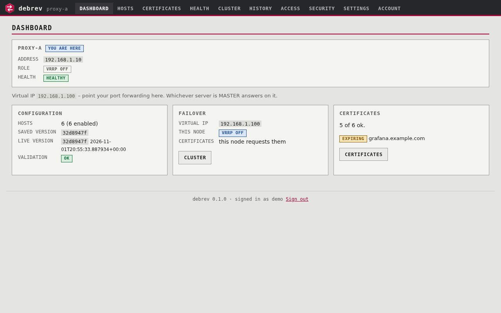
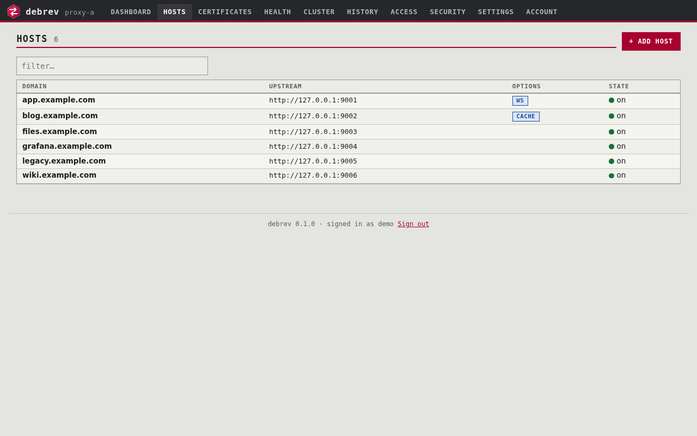
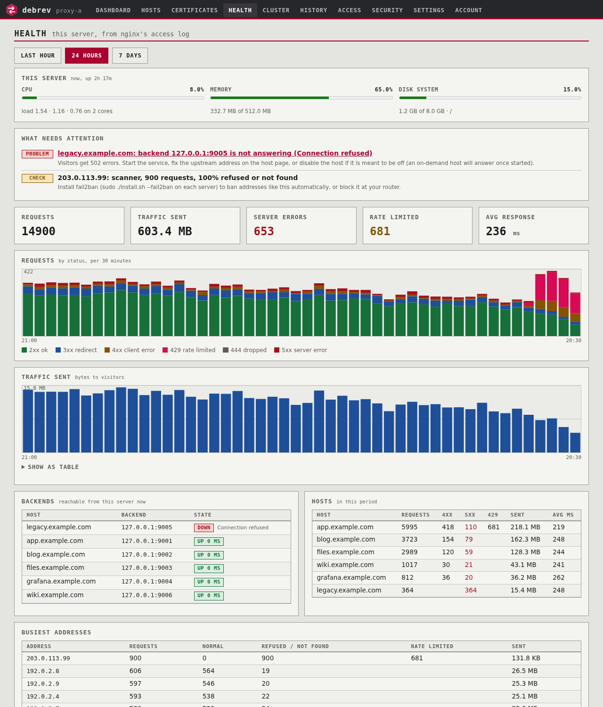
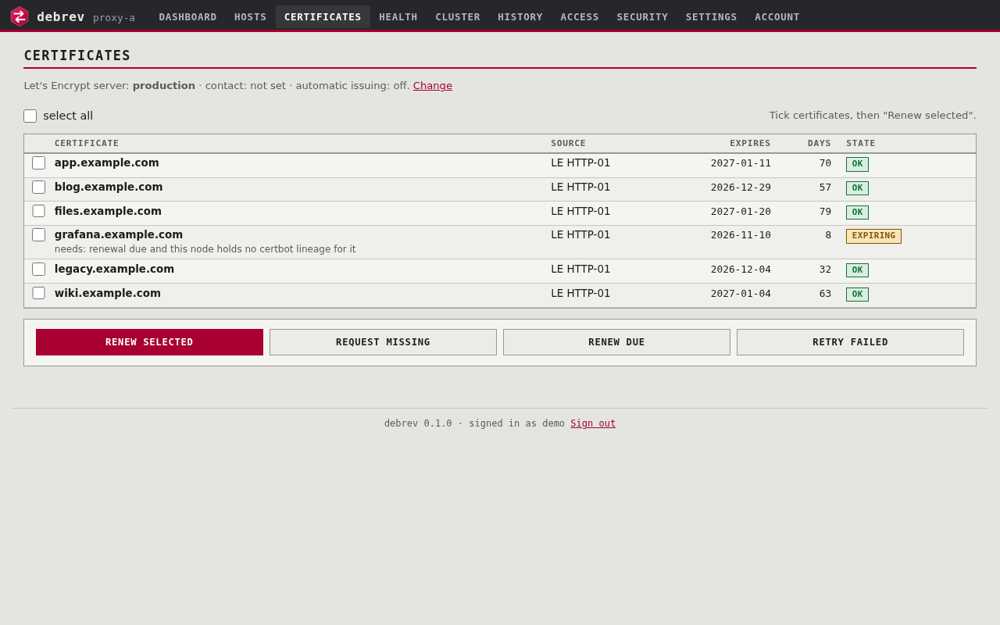
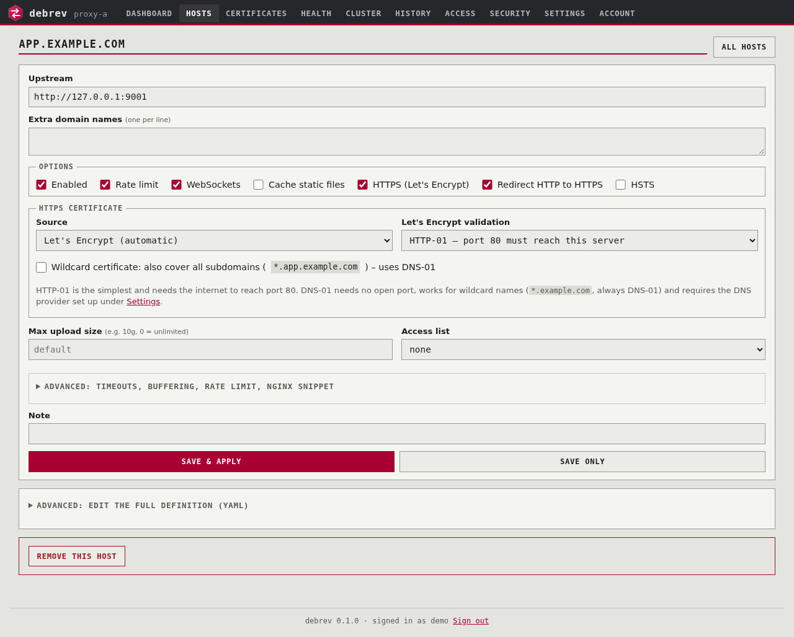
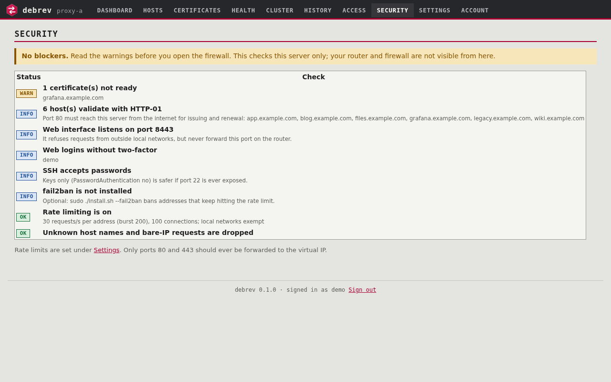
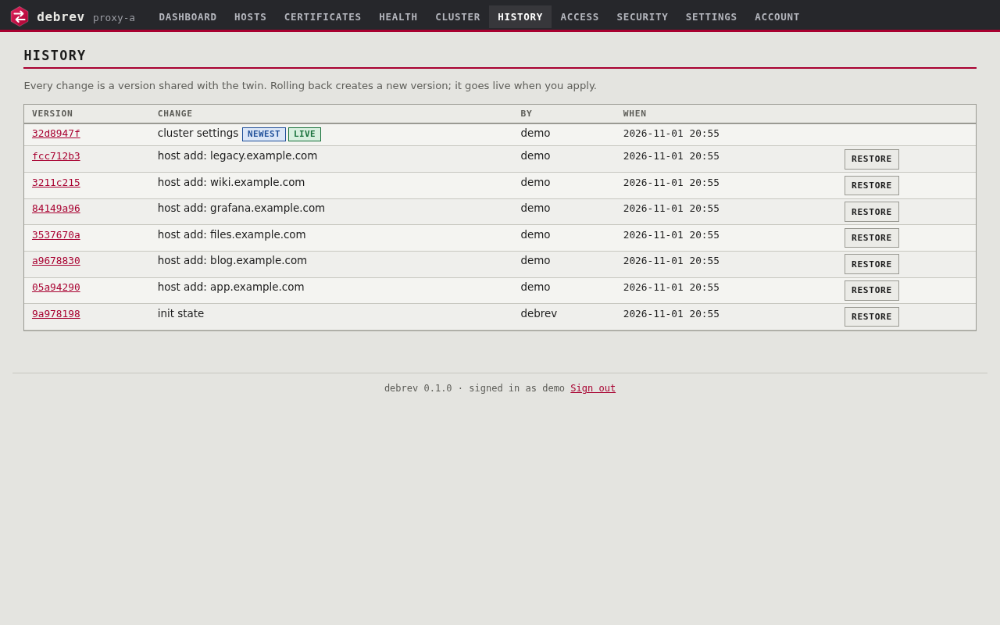
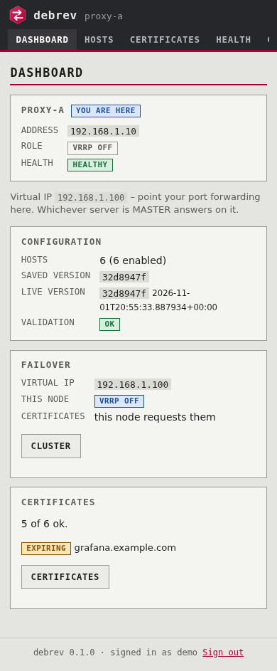

# debrev

Reverse proxy manager for Debian: nginx + certbot, git-versioned config, twin-server sync, no Docker.
See `docs/DESIGN.md` and `docs/ROADMAP.md`.

## Screenshots
All screenshots show a demo instance with example.com data (`tools/demo.py`, `tools/screenshots.py` rebuild them).

| | |
|---|---|
|  **Dashboard**: both servers, who holds the virtual IP, certificates |  **Hosts** |
|  **Health**: traffic, backends, scanners, suggestions |  **Certificates**: renew selected, due or failed |
|  **Host settings**: HTTPS, wildcard, rate limit, advanced |  **Security** checklist |
|  **History**: every change is a commit, roll back any time |  **On a phone** |

## Status
Phases 1-6 (core engine, CLI, Let's Encrypt, twin sync, failover/drain, web UI, join/update) and the abuse-protection part of phase 7 are implemented. The join script (`install.sh --join`) is in.

## Install (first node)
```
sudo git clone https://github.com/pascalbrax/debrev.git /opt/debrev && cd /opt/debrev
sudo ./install.sh --init          # --dry-run to preview
```
All dependencies come from stock Debian apt (`requirements.apt`). Developed on Debian 13 (trixie) and tested on a
fresh Debian 12 (bookworm) install as well (nginx older than 1.25.1 gets the older HTTP/2 syntax automatically).

Install into a **root-owned directory such as `/opt/debrev`**: keepalived silently disables its health check for scripts
that someone else owns or can write, and the node would then never fail over. `install.sh` refuses to continue in that case.

## Use
```
sudo -u debrev debrev host add app.example.com http://127.0.0.1:3000 --websockets --cache
sudo -u debrev debrev apply            # validate -> test -> swap -> reload -> health check (auto rollback)
sudo -u debrev debrev apply --check    # test only, changes nothing
debrev host list | host show <d> | host edit <d> | host rm <d>
debrev history | diff [rev] | rollback [rev] | status | render | validate
debrev export -o config.yaml           # hosts, access lists and settings in ONE file (no certificates, keys or tokens)
debrev import config.yaml              # preview what an import would do
debrev import config.yaml --write      # save it (not live until 'debrev apply'); existing hosts are skipped
         [--overwrite]                 #   ... replace hosts/access lists that already exist
         [--settings]                  #   ... also import the settings (Let's Encrypt, DNS providers, failover, rate limits)
debrev user add|passwd|rm|list|no2fa   # web interface accounts (uses sudo when needed)
```
State lives in `/var/lib/debrev/state` (a git repo of YAML: `hosts/`, `access_lists/`, `settings.yaml`).
Every change is a commit; `apply` refuses to run with uncommitted changes.

### Moving a configuration between servers
`Hosts > Export / import` in the web interface does the same: download one YAML file, upload it on another server,
check the preview, save, then **Apply now**. The file never contains certificates (a new server requests its own, or
receives them from the twin), private keys, DNS API tokens (settings only name the token *file*) or web logins, so it is
safe to keep in a repository. Importing never touches anything until you apply, and a file that fails validation is
rolled back completely. Plain `{hosts: [...]}` lists from older versions are still accepted.

## Host file reference
```yaml
domain: app.example.com
aliases: [www.example.com]
upstream: http://127.0.0.1:3000        # http(s)://host[:port][/path]
websockets: true
preserve_host: true                    # false -> Host header = upstream host
tls: { enabled: true, cert: auto, challenge: http, force_https: true, hsts: false, http2: true }
                                       # cert: auto = Let's Encrypt (challenge: http | dns)
                                       # cert: custom = your own certificate (see "Your own certificates")
cache: { enabled: true, ttl: 10m, static_only: true, bypass_cookies: [session], max_size: 1g }
max_body: 100m                         # 0 = unlimited
buffering: true                        # false for streaming / S3; request_buffering likewise
rate_limit: true                       # false = off, or own limits: {rate: 200, burst: 2000, connections: 500}
timeouts: { connect: 5s, read: 60s, send: 60s }
request_headers: { X-Env: prod }       # sent to the upstream
response_headers: { X-Frame-Options: SAMEORIGIN }
access_list: office                    # access_lists/office.yaml: {allow: [10.0.0.0/8]}
custom_locations: [{ path: /api/, upstream: "http://127.0.0.1:8080", websockets: false }]
custom_snippet: |                      # raw nginx inside server{}; validated, dangerous directives blocked
  location /healthz { return 200 "ok"; }
enabled: true
```
Every host carries all its own settings (no shared presets, so editing one host never changes another). The host page has an *Advanced* section for timeouts, buffering, rate limit and extra nginx configuration; ready-made settings for Nextcloud, MinIO, WebSocket apps and so on are in `docs/RECIPES.md`. Upgrading from an older install that used presets: `debrev migrate-presets` once (copies the settings into the hosts).

## Let's Encrypt
```
debrev acme set --email you@example.org --staging   # staging = untrusted test certificates, generous limits
debrev certs issue                                  # get missing certificates, then re-apply
debrev certs list                                   # expiry, issuer, validation method, last error
```
Per host you choose how Let's Encrypt validates the name (web interface: host page, "HTTPS certificate"; file: `tls.challenge`):

| | HTTP-01 (default) | DNS-01 |
|---|---|---|
| Needs | port 80 reachable from the internet | an API token for your DNS provider |
| Wildcards (`*.example.org`) | no | yes (always DNS-01) |
| Closed firewall | no | works |

- **DNS-01 setup:** `apt install python3-certbot-dns-<provider>` (Debian has cloudflare, infomaniak, route53, google, rfc2136, desec ...), create the credentials file (mode 600, e.g. `/etc/letsencrypt/infomaniak.ini`), then in *Settings* (or `debrev acme set --dns-plugin infomaniak --dns-credentials /etc/letsencrypt/infomaniak.ini --dns-propagation 90`). **The credentials file is copied to the twin automatically** (root-only channel, newest copy wins, within a minute).
- **Settings page:** every DNS provider is a card with live status (plugin installed? token file present on this server? how many hosts use it), a *default* choice and a remove box; the empty card at the end adds one. On the *Certificates* page tick any Let's Encrypt certificates and press *Renew selected* (`debrev certs renew NAME...`), which renews them now even if not due and ignores the retry delay.
- **Several DNS providers:** domains can live at different providers. The default provider is `acme.dns`; add more under `acme.dns_providers` (Settings → Additional providers, or `debrev acme set --dns-plugin cloudflare --dns-credentials /etc/letsencrypt/cloudflare.ini --dns-name cloudflare`) and pick one per host (`tls: {challenge: dns, dns_provider: cloudflare}`, or the host form). All credential files are copied to the twin.
- Providers without a certbot plugin (for example Hostpoint, FreeDNS): use HTTP-01 for those hosts. CNAME delegation of `_acme-challenge` to a supported zone is NOT supported by certbot's plugins (a debrev hook for it is planned, not built).
- **Wildcards:** tick *Wildcard certificate* on the host page (or `debrev host add example.com URL --wildcard`): the certificate then also covers `*.example.com` (one label deep, DNS-01 only, needs a DNS provider). Other names under it can use the same wildcard by having their own host entry.
- Until a host has a certificate it is served over plain HTTP with a warning; the next apply after issuing turns on HTTPS.
- Renewal runs from Debian's `certbot.timer` (certbot waits a random delay of up to 8 minutes before renewing, on purpose); a deploy hook publishes the certificate, reloads nginx and sends it to the twin. `acme set --auto` lets a timer also *request new* certificates by itself.
- The server that holds the virtual IP is the one that requests certificates; the twin receives them.

## Your own certificates
For a certificate from another CA (company CA, purchased, wildcard ...): set the host to *My own certificate* (`tls: {cert: custom}`), then upload it:
```
debrev host add app.example.org http://10.0.0.5:80 --own-cert
debrev certs upload app.example.org --cert fullchain.pem --key privkey.pem
```
or paste it on the host's page in the web interface (there is a "load from file" button). debrev checks it before installing: valid PEM, key not password protected, key matches, not expired, and the certificate covers the host's domain and every alias (a `*.example.org` certificate covers one label). It is stored root-only, applied, and copied to the twin; the more recently installed copy wins on both servers. `cert_path`/`key_path` (both, absolute) still work if you manage the files yourself, but those are not synced.

## Twin server (two nodes)
On each node: `sudo ./install.sh --init`. Then, as the `debrev` user (`sudo -u debrev debrev ...`):
```
# node A (issues certificates)                       # node B (receives them)
debrev peer set <B-ip>                               debrev peer set <A-ip>
debrev peer keygen   -> key A                        debrev peer keygen   -> key B
debrev peer authorize '<key B>'                      debrev peer authorize '<key A>'
                                                     debrev node set --issuer no
debrev peer test                                     debrev peer test
                                                     debrev sync --take-theirs --yes   # adopt A's state (backup branch kept)
```
After that every `debrev apply` notifies the twin, which fetches, validates and applies. `debrev status` shows `sync:`.
Diverged histories are never merged automatically: use `debrev sync --take-theirs --yes` or `--take-mine --yes`.
Certificates are issued on the node with `acme_issuer = yes` and copied to the twin; nginx on both forwards unknown ACME tokens to the other.

### Adding or rebuilding the twin with one command
On a fresh Debian server, with a clone of this repository under `/opt/debrev`:
```
sudo ./install.sh --join <ip-of-the-running-node>        # asks for that node's root password once
#   --peer-user NAME   log in with another account (needs passwordless sudo there)
#   --priority N       keepalived priority (default: 10 below the peer, never above 100)
#   --yes              do not ask before replacing the peer's current twin
```
It installs everything, creates this server's sync key, logs in to the running node once to authorize it there, adopts the node's hosts and settings (a backup branch of any local state is kept), applies, and asks the node to send the certificates. This server becomes a non-issuing twin; create its web logins with `sudo debrev user add NAME`. Running `--join` again on a paired server is harmless. If the login does not work the script prints the manual commands. With root SSH disabled use `--peer-user` and the two sudo lines in `docs/ACCESS.md`.

### Updating
```
cd /opt/debrev && git pull && sudo ./install.sh --update     # on each node, one at a time (debrev drain / restore)
```
The joined twin also gets its automatic Debian upgrades 12 hours after the first node, so both are never upgrading at once.
`--update` refreshes packages, services, timers and sudoers and re-applies; your configuration is kept.

See `docs/ACCESS.md` for working without root SSH: admin account for `--join`, a restricted deploy key, and turning root password login off.

## Failover and upgrades
```
debrev cluster set --vip 192.168.1.230      # once, any node; synced to the twin
debrev node set --priority 150                # on the preferred node (the other keeps 100)
debrev cluster show                           # who holds the virtual IP, health of both nodes
```
Point DNS / port forwarding at the virtual IP. To upgrade a node:
```
debrev drain          # moves the virtual IP to the twin; refuses if the twin is not healthy
apt update && apt full-upgrade ; reboot if needed
debrev restore        # eligible again; the preferred node takes the IP back when healthy
```
A crashed nginx or keepalived fails over by itself (seconds). A drained node stays drained across reboots.

## Web interface
`https://<server>:8443` (self-signed certificate; reachable from local networks only). Create a login first on each server:
```
sudo debrev user add alice        # asks for a password (min 10 characters)
```
Dashboard (both servers, who is MASTER, "you are here"), hosts, certificates (Let's Encrypt and your own), history/rollback, cluster drain/restore, Let's Encrypt and DNS-provider settings are all there; it works on phones. Turn on two-factor login on the Account page. Saved changes go live with "Apply now". Never port-forward 8443 to the internet.

## Health page
*Health* in the web interface (this server's own traffic, from nginx's JSON access log `/var/log/nginx/debrev.log`, counted every minute by `debrev-traffic.timer` into `/var/lib/debrev/traffic.db`, 8 days kept): suggestions, requests by status and traffic charts (hour / 24 hours / 7 days, with a table view), live backend reachability, per-host and per-address tables (scanners stand out) and the latest requests (all or errors only). Query strings are never logged. `debrev traffic collect` runs the counter by hand. Each server shows its own traffic; open the twin's address to see the other.

## Security and abuse protection
```
debrev security                       # exposure checklist (also in the web interface: Security); exit 1 = not ready
debrev security set --rate 30 --burst 200 --connections 100 [--rate-limit off] [--lan-exempt on]
sudo ./install.sh --fail2ban          # optional: ban addresses that keep hitting the limit
```
- **Rate limiting** (on by default, `settings.yaml: security`): per client address requests/second with a burst, plus simultaneous connections; over the limit the visitor gets `429`. Local networks are never limited unless you turn `lan_exempt` off. A host with huge transfers (speed tests) can opt out with `rate_limit: false`, and a busy one (Nextcloud sync, S3 clients) can have its own, higher limits: `rate_limit: {rate: 200, burst: 2000, connections: 500}` (host page > Advanced). Values you leave out come from Settings.
- nginx (Debian's default config hides the version) closes slow or stuck clients early, and answers requests for unknown host names or a bare IP by hanging up.
- The checklist tests: rate limiting, the catch-all behaviour (live probe), certificates (staging or missing), hosts without HTTPS, HTTP-01 hosts (they need port 80 from the internet), listening ports, web logins without 2FA, SSH password login. It cannot see your router: forward only 80 and 443 to the virtual IP, never 8443 or 22.
- The web interface itself refuses every address outside local networks, even if the port were exposed by mistake.

## Tests
`python3 -m pytest tests` (needs `python3-pytest`; nginx and openssl for the full-config test).

## Known limitations
- nginx will not load a config whose upstream *hostname* does not resolve, so a bad hostname fails the apply (safe, but also blocks other changes). Use IPs or fix DNS; a runtime-resolve option is planned.
- Rollback of the live config swaps a symlink then runs `nginx -t`; the isolated pre-test runs first so the live config is normally never touched by a bad render.

## License
debrev is free software, released under the [GNU General Public License, version 3](LICENSE) (GPL-3.0).
You may use, study, change and share it; changes you distribute must stay under the same license.
